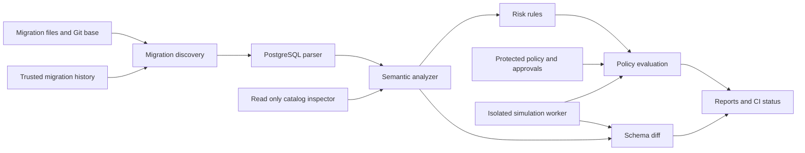
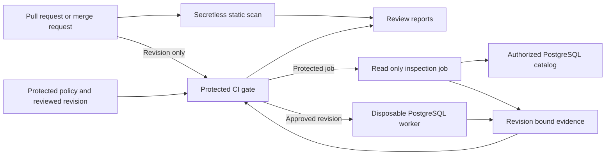

# Database Migration Guard implementation plan

**Planning proposal · 12 November 2026**

## 1. Product requirements

Database Migration Guard gives developers, database reliability engineers, and platform teams a merge-time decision for PostgreSQL migrations. A developer changes SQL, CI identifies affected migrations, and reviewers get findings at the relevant source lines with a reason, evidence, and a mitigation. Organizations can require approvals or additional evidence for selected changes. The existing migration runner owns deployment.

| Release | Scope | Acceptance outcome |
| --- | --- | --- |
| MVP | Offline CLI for plain SQL and SQLx on PostgreSQL 17–18. Forward migration discovery, file integrity against a trusted Git base, deterministic risk rules, versioned TOML policy, text and JSON output, Markdown PR summaries, and a GitHub Actions check. | A pilot repository can install a pinned build, identify a risky change in a PR, block it with protected policy, and pass a corrected change without a database or network connection during the scan. |
| Core v1 | Add Flyway, Goose, and Supabase SQL adapters, supported history checks, read-only catalog inspection, disposable simulation across supported majors, structural diff, application schema contracts, audited exceptions, full reports, GitLab CI, and validated binary and container distribution. | A team can use the merge gate and a protected pre-deploy workflow with the documented formats, database versions, and evidence controls. |
| After core v1 | Validate demand for centralized self-hosted reporting, team policy distribution, audit search, trends, and optional AI explanations. | Approve each extension against adoption evidence and its own acceptance criteria. |

Measure time to first passing CI check, the proportion of actionable findings, confirmed regressions missed in a reviewed sample, incomplete-analysis frequency, and reviewer effort. Collect pilot metrics by agreement using sanitized aggregates. The CLI operates offline by default.

## 2. Competitive analysis

| Product | Documented capabilities | What the pilot should compare |
| --- | --- | --- |
| Squawk | PostgreSQL migration linter with rule-level remediation and a GitHub integration. [Squawk documentation](https://squawkhq.com/docs/) | Compare rule accuracy, source locations, setup time, and the effort of applying exceptions in the same SQL repositories. |
| Atlas | Migration linting, ephemeral development databases, and migration tests that exercise database state. [Migration safety](https://atlasgo.io/versioned/lint), [dev database](https://atlasgo.io/concepts/dev-database), [migration tests](https://atlasgo.io/testing/migrate) | Compare setup and evidence quality for a versioned migration rehearsal with a representative baseline and test data. |
| Bytebase | PostgreSQL schema comparison and migration workflows alongside SQL review rules and approval routing. [PostgreSQL capabilities](https://www.bytebase.com/databases/postgres/), [SQL review](https://www.bytebase.com/sql-review/) | Compare policy administration and reviewer effort with a CLI installed alongside an existing migration runner. |
| Flyway | Versioned and repeatable migration management, history validation, drift checks, and deployment-script preview. [Validate](https://documentation.red-gate.com/flyway/reference/commands/validate), [Check](https://documentation.red-gate.com/flyway/reference/commands/check) | Test whether Guard adds actionable findings for teams that already use Flyway validation and checks. |
| pgroll | Runs expand-and-contract migrations by serving multiple PostgreSQL schema versions during a rollout. [pgroll project](https://github.com/xataio/pgroll) | Compare how well schema contracts identify compatibility breaks in teams using conventional SQL rollout workflows. |
| pganalyze | Observes live PostgreSQL lock contention and blocking sessions. [Lock monitoring](https://pganalyze.com/docs/connections) | Check whether reviewers can use static lock findings and rehearsal evidence to make a pre-merge decision. |

Initial positioning is a PostgreSQL pre-merge gate that fits existing migration repositories. The differentiation hypothesis is that framework-aware history checks, explainable policy decisions, and evidence tied to the same migration revision reduce the cost of reviewing changes. Validate that with shared fixtures, pinned competitor versions, and pilot interviews before making comparative claims.

## 3. Technical feasibility

| Feasibility question | Phase 0 evidence required |
| --- | --- |
| PostgreSQL grammar and Rust portability | Compare a pinned PostgreSQL-derived parser via `pg_query` and `libpg_query` with the PostgreSQL dialect in `sqlparser-rs`. Record PostgreSQL grammar version, AST and span fidelity, malformed-input behavior, dependency licenses, and build requirements. Build the preferred parser on Linux, Windows, and macOS and test representative statements against real PostgreSQL 17 and 18. [Rust binding](https://github.com/pganalyze/pg_query.rs), [native build](https://github.com/pganalyze/pg_query.rs/blob/main/build.rs), [PostgreSQL parser library](https://github.com/pganalyze/libpg_query), [Rust dialect parser](https://github.com/apache/datafusion-sqlparser-rs) |
| Fidelity of framework adapters | Pin runner versions and capture representative fixtures. Compare discovery order, transaction handling, and history observations against the native runner. Record unsupported runner settings explicitly. |
| Useful catalog access with restricted privileges | Identify the minimum permissions per catalog field. Demonstrate useful findings with a restricted role, report unavailable fields, and measure inspection overhead under representative contention. |
| Simulation of migration SQL | Demonstrate disposable instance ownership, network and filesystem isolation, resource limits, transaction fidelity, and cleanup after forced cancellation before enabling the feature. |
| Risk-rule accuracy | Validate representative lock, rewrite, and constraint behavior against real servers. Agree on a reviewed holdout corpus and record false positives, missed findings, and unsupported cases by rule. |

The preferred parser depends on native tooling. Guard development uses Rust 1.100.0 and the PostgreSQL 18.6 grammar bundled by `pg_query` 18.1.0. Advertised CLI platforms require clean native build and offline runtime evidence.

### Phase 0 research status

- **DMG-01 conformance spike is integrated.** The three candidates yielded 126 matching parser observations across Windows x86-64 and Linux x86-64, with 24 server observations on PostgreSQL 17.12 and 18.7. Use `pg_query` 18.1.0 in Guard and apply explicit target-version checks. Use scanner token ranges for statements and actions, with statement or segment diagnostics through the public binding. The spike records the redistribution notices and native build prerequisites. macOS arm64 and a disconnected Windows VM remain release acceptance checks. [Spike results and reproduction steps](spikes/dmg-01-parser/README.md) · [Parser decision brief](docs/research/postgresql-parser.md)
- **DMG-02 development corpus is integrated.** It covers 28 case designs, 65 reproducible Git pairs, and 130 adapter and PostgreSQL-major combinations. Recorded evidence includes 82 native runner executions and 10 two-session lock probes across PostgreSQL 17.12 and 18.7. In the SQLx opt-out cases, the single concurrent index build passed and the multi-statement batch returned `25001`, rolled back the preceding change, and left no candidate history row. Two independent reviewers confirmed the private synthetic holdout freeze for 100 combinations. The first Guard candidate matched all 100 gate and coverage outcomes, 16 of 16 exact destructive findings, and 48 of 64 exact required findings. [Development fixtures](fixtures/dmg-02/README.md) · [Native evidence](fixtures/dmg-02/evidence/README.md) · [Holdout protocol](fixtures/dmg-02/holdout.md) · [Holdout score](PROGRESS.md#dmg-06-first-frozen-holdout-score)
- **The local competitor pilot is recorded.** Guard, Squawk 2.72.0, and Atlas Community 1.3.0 ran on seven shared plain SQL cases for both PostgreSQL majors. The evidence records findings, exits, rules available in each edition, and Atlas's statement-by-statement replay. Hosted pilot adoption, exception workflow, and reviewer time remain open. [Comparison and reproduction](fixtures/dmg-02/evidence/competitor-pilot.md)

## 4. Functional requirements

| ID | Requirement |
| --- | --- |
| F1 | Discover SQL in configured roots using explicit adapter and ordering settings. Detect duplicate migration identities, ordering inconsistencies, and modified or missing files against trusted evidence. Preserve original paths and source locations. |
| F2 | Analyze supported PostgreSQL DDL and DML offline. Report syntax errors, unsupported constructs, unresolved dependencies, and mismatched target versions with explicit coverage status. |
| F3 | Evaluate a versioned organization policy over deterministic findings and required evidence. Support severity thresholds, rule settings, protected overrides, audited approvals, and expiring exceptions. |
| F4 | Reconcile local files with authorized applied-history evidence to classify pending, applied, modified, missing, failed, or unknown states where the adapter has sufficient evidence. |
| F5 | Collect optional, scoped PostgreSQL metadata. Use observed facts and bounded estimates to refine lock, rewrite, dependency, and compatibility findings. |
| F6 | Simulate selected migrations on a fresh PostgreSQL instance, record timings, constraint outcomes, partial failures, and the schema delta. Bind results to the exact inputs used. |
| F7 | Compare expected, current, and proposed schemas. Flag changes affecting existing application versions and evaluate optional versioned schema contracts. |
| F8 | Expose stable CLI behavior and reports for humans and automation. Distribute verified binaries, a container image, GitHub Action, and GitLab CI examples. |

### Migration adapters

| Adapter | Planned behavior and support boundary |
| --- | --- |
| Plain SQL | Require an explicit version pattern and ordering. Model transaction behavior from a declared runner setting and explicit SQL boundaries. Use a trusted manifest or Git base for file integrity and an explicit applied manifest for pending detection. |
| SQLx | Cover single-file versioned migrations and reversible SQL pairs in MVP, with v0.8.6 as the first parity target. Keep down migrations outside the forward plan. Model both the runner's transaction wrapper and the implicit transaction PostgreSQL can apply to a multi-statement query after the runner opts out of its wrapper. In v1 validate native history and checksum behavior against each supported SQLx version. [SQLx v0.8.6 loader](https://raw.githubusercontent.com/launchbadge/sqlx/v0.8.6/sqlx-core/src/migrate/source.rs), [SQLx v0.8.6 execution](https://github.com/transact-rs/sqlx/blob/v0.8.6/sqlx-postgres/src/migrate.rs#L190-L272), [PostgreSQL message flow](https://www.postgresql.org/docs/18/protocol-flow.html#PROTOCOL-FLOW-MULTI-STATEMENT) |
| Flyway | Support versioned and repeatable SQL with their own ordering and history semantics. Model supported transaction settings. Recognize undo files separately. Diagnose unresolved placeholders, callbacks, and unsupported ordering or grouping settings. Validate native checksums against runner fixtures. [Versioned migrations](https://documentation.red-gate.com/fd/versioned-migrations-273973333.html), [repeatable migrations](https://documentation.red-gate.com/flyway/flyway-concepts/migrations/repeatable-migrations), [validation](https://documentation.red-gate.com/flyway/reference/commands/validate), [transaction setting](https://documentation.red-gate.com/flyway/reference/configuration/flyway-namespace/flyway-execute-in-transaction-setting) |
| Goose | Honor Up and Down sections, grouped statement annotations, and transaction opt-outs. Flag environment substitution until there is a bounded way to provide trusted values. Use a Guard manifest for content integrity where the source history supplies only applied status. [Goose SQL annotations](https://pressly.github.io/goose/documentation/annotations/) |
| Supabase | Discover timestamped SQL under `supabase/migrations`. Reconcile timestamp identities with authorized history. Use a Guard manifest or trusted Git ref for file integrity. Document extension and managed-schema requirements for simulation. Pin CLI versions for fixtures because CLI v3 changed remote target selection. [Database migrations](https://supabase.com/docs/guides/deployment/database-migrations), [CLI reference](https://supabase.com/docs/reference/cli/supabase-migration-list), [CLI v3 changelog](https://supabase.com/changelog/supabase-cli-v3) |

Compute a Guard content digest over the original file bytes. Compare native history only with checksums and identities defined by that runner. A Git-only comparison can establish a file change relative to a base. Establishing whether it has been applied requires applied-history evidence. Assess Prisma's migration-directory format as a follow-on adapter candidate. [Prisma migration history](https://docs.prisma.io/docs/orm/v7/prisma-migrate/understanding-prisma-migrate/migration-histories)

## 5. Non-functional requirements

- **Determinism** — Identical migration bytes, ordered inventory, target version, policy, context, and evaluation time produce equivalent findings, fingerprints, and decisions. Sort results and keep runtime timing outside the deterministic comparison.
- **Portability** — Run offline scans headlessly on supported Linux, macOS, and Windows targets. Test native path handling, CRLF, Unicode, and operation without credentials. Simulation requires a supported isolated worker.
- **Compatibility** — Version policy, rules, JSON, and schema snapshots. Keep rule IDs stable, allow additive report fields within a major schema version, and document breaking changes and migration steps.
- **Reliability** — Bound input size, depth, CPU, memory, network and process time, and concurrency. Publish reports atomically. Cancellation and repeated runs must leave the next check with a consistent view.
- **Privacy and operability** — Redact connection data and sensitive SQL by default. Reports identify the exact inputs and any evidence gaps. Terminal and CI output must remain useful without a network connection.
- **Proposed performance budgets** — Start with p95 at or below 15 seconds and peak RSS at or below 512 MiB for an offline scan of 5,000 files totaling 50 MiB on a 2-vCPU, 8-GiB Linux x86-64 runner. Establish a baseline over at least 30 runs and lock the release budget after the Phase 0 spike. Measure large single scripts, complex catalog snapshots, rendering 10,000 findings, and four concurrent scans separately. These are planning targets. Publish measured results with runner, tool version, corpus, cache state, and repetitions.

## 6. Architecture diagrams

The CLI orchestrates the pipeline. Optional database capabilities feed typed evidence into the analysis. Static mode requires only local inputs.

The trusted CI gate verifies the revision and evidence digests. Give the analyzer, catalog collector, and rehearsal worker separate privilege contexts. The collector receives a trusted target and a bounded scope. A reviewed revision and protected policy authorize rehearsal.

## 7. Module specifications

| Cargo workspace module | Responsibility and contract |
| --- | --- |
| Core types and engine interface | Define migration identity, original source span, PostgreSQL target, normalized operation, schema snapshot, finding, evidence, and policy decision. Define engine capabilities with PostgreSQL as the sole initial implementation. |
| Migration discovery | Inventory files under bounded roots, resolve adapter-specific identities and order, map Up and Down sections, and reconcile trusted history. Return diagnostics with a provenance-bearing migration plan. |
| SQL parser | Encapsulate parser and native bindings. Return AST-derived operations and source spans with explicit unsupported or failed states. Preserve byte offsets through adapter slicing. |
| PostgreSQL analyzer | Resolve object identity and relevant version semantics against a schema snapshot and earlier supported statements. Record assumptions, transaction context, and affected objects. |
| Risk and policy engines | Classify operation risks with stable rule IDs and evidence. Apply versioned organization policy and produce an auditable decision with the matched rules and exceptions. |
| PostgreSQL inspection | Use fixed catalog queries for bounded read-only snapshots and history reads. Return metadata with permissions, timestamp, version, and availability. |
| Schema diff | Compare canonical supported objects and emit typed changes with ambiguity and coverage annotations. |
| Simulation engine | Own disposable worker lifecycle, framework-aware execution, observations, and teardown. Return execution evidence and before-and-after snapshots. |
| Report engine and CLI | Orchestrate explicit workflows and render one versioned report model. Keep side effects in CLI or worker adapters. |
| Integrations and optional API | Adapt reports and exit status for CI providers. A later Axum API and Angular UI consume versioned reports without adding web dependencies to core analysis. |

Use Clap for CLI parsing, Serde for versioned formats, Tracing for diagnostics, and typed errors at module boundaries. Evaluate Tokio and `tokio-postgres` with a verified TLS connector during the inspector spike. Static commands should have no required service or local database. Evaluate SQLite when an optional local history feature has a demonstrated need.

## 8. SQL analysis design

1. Inventory configured roots before selecting changed files. Normalize repository-relative paths, reject paths that escape the workspace, and use the framework's ordering and transaction metadata. Include deletions, renames, and affected migration identities in CI.
2. Parse each forward SQL segment using PostgreSQL grammar. Preserve original UTF-8 byte ranges through segment extraction, then map to one-based lines and columns for reporting. Test comments, dollar-quoted bodies, multi-action ALTER statements, and multibyte input. Emit explicit diagnostics for failed parses, client directives, unsupported procedural or dynamic SQL, and unresolved templating.
3. Normalize each supported operation and subcommand into typed facts. Resolve quoted and schema-qualified names against the configured search path and available snapshot. Update only the portion of schema state supported by the analyzer as earlier migrations are processed. Track unresolved object identity, dependencies, and version-specific syntax. Treat IF EXISTS and IF NOT EXISTS as branches when object existence is unknown.
4. Model lock modes, table scans and rewrites, index rebuilds, transaction boundaries, broad data updates, and compatibility hazards. Account for the strongest lock in a combined ALTER and the time it can be held across a transaction. Distinguish a newly created relation whose identity and lifetime are established from an existing or unresolved relation. Use known size and row-estimate data to refine plausible impact.
5. Surface the state of each statement and required input in the report. Target-version syntax that the selected parser accepts but the declared server rejects is a compatibility diagnostic. Use cross-version server fixtures to verify that distinction.

## 9. PostgreSQL version compatibility

This is the target matrix. PostgreSQL 14 reached upstream end of life on 12 November 2026 and PostgreSQL 19 is at release candidate stage as of this plan. Recheck upstream support at each release and test the latest verified minor for each claimed major. [Upstream support policy](https://www.postgresql.org/support/versioning/), [12 November release notice](https://www.postgresql.org/about/news/postgresql-187-1712-1616-1520-1425-and-19-rc-2-released-3442/)

| PostgreSQL major | MVP | Core v1 | Matrix emphasis |
| --- | --- | --- | --- |
| 14 and earlier | Outside supported scope | Outside supported scope | Clear unsupported-target diagnostic |
| 15 | Deferred | Full core target if upstream-maintained at ship | Earliest supported catalog shape and DDL behavior |
| 16 | Deferred | Full core target | Catalog, partition, transaction, and drift fixtures |
| 17 | Static analysis target | Static, inspection, diff, and simulation target | Older grammar fixtures and deferred constraint validation |
| 18 | Static analysis target | Static, inspection, diff, and simulation target | PostgreSQL 18 constraint syntax and catalog behavior |
| 19 and later | Watch list | Candidate after GA and validation | Require matching parser coverage, catalog fixtures, and sandbox image acceptance |

Use the PostgreSQL 18 named NOT NULL constraint with deferred validation to test version-specific syntax. A NOT VALID foreign key on a partitioned table also exercises version-specific execution because PostgreSQL 17 can parse the command and then reject it. Record parser acceptance and server execution separately on both majors. The support matrix applies to the documented statement, object, and adapter subset. [PostgreSQL 18 release notes](https://www.postgresql.org/docs/18/release-18.html), [PostgreSQL 17 execution check](https://github.com/postgres/postgres/blob/REL_17_12/src/backend/commands/tablecmds.c#L10275-L10290)

## 10. Risk classification and policy

| Severity | Default meaning |
| --- | --- |
| INFO | An observation that aids review. |
| LOW | Localized risk or a deployment prerequisite with limited expected impact. |
| MEDIUM | A scan, lock, or compatibility issue that merits review, with impact dependent on workload or context. |
| HIGH | Credible writer blocking, a costly rewrite, broad data change, or likely breakage during a rolling deployment. |
| CRITICAL | Credible irreversible data loss or a confirmed violation of a critical application schema contract. |

Each finding records a stable rule ID, severity, source span, affected object, explanation, impact, mitigation, documentation link, confidence, and evidence provenance. Report evidence as an observed input fact, static prediction, catalog estimate, or simulation observation. Confidence is high when the trigger is established, medium when it relies on a material assumption, and low when key semantics are unresolved. Runtime impact remains a separate judgment. Use the highest applicable rule severity and retain individual findings. A future summary score must preserve critical findings and have no policy authority.

| Proposed rule ID | Trigger and default severity | Mitigation and evidence |
| --- | --- | --- |
| PG001 | CRITICAL for DROP TABLE, DROP COLUMN, or TRUNCATE when an existing relation may lose data. A proven empty relation created in the same migration can lower impact. | Show dependencies and a staged deprecation or recovery decision. |
| PG002 | HIGH for renaming or removing an existing object, or an incompatible type or write constraint that affects a declared application dependency. MEDIUM for other plausible compatibility risks. Escalate a proven violation of a critical contract to CRITICAL. | Label heuristic findings as potential compatibility risks. Recommend an expand-and-contract sequence where applicable. |
| PG003 | HIGH for a probable table rewrite on an existing relation. Distinguish nullable adds, non-volatile and volatile defaults, and type changes with known casts or index effects. | Report lock and rewrite risks independently. Suggest an additive column and bounded backfill where appropriate. [ALTER TABLE behavior](https://www.postgresql.org/docs/18/sql-altertable.html) |
| PG004 | MEDIUM for a constraint validation or SET NOT NULL likely to scan existing data. Raise to HIGH when it combines a write-blocking lock with size above an explicit policy limit. | Recommend staged validation where supported. A validated check proving non-nullness can remove a separate scan in supported cases. [Constraint behavior](https://www.postgresql.org/docs/18/sql-altertable.html) |
| PG005 | HIGH for a regular CREATE INDEX on an existing or unresolved relation. MEDIUM for DROP INDEX with plausible workload impact. Evaluate dependent constraints through the compatibility rule. | Check concurrent operation eligibility for the target, relation, and transaction plan. Explain invalid index cleanup after a failed concurrent build. [CREATE INDEX](https://www.postgresql.org/docs/18/sql-createindex.html), [DROP INDEX](https://www.postgresql.org/docs/18/sql-dropindex.html) |
| PG006 | HIGH for UPDATE or DELETE with an absent or obviously broad predicate. | Recommend bounded work where relevant. Use table row estimates as context and express uncertainty about how many rows a predicate will affect. |
| PG007 | HIGH for operations incompatible with their execution block, a write-blocking lock held across lengthy migration work, or a proven ordering dependency on a later migration. | Show the affected transaction or dependency and explain rollback or partial-apply implications where supported. [Explicit locking](https://www.postgresql.org/docs/18/explicit-locking.html) |

Default `check` requires complete analysis of configured scope and blocks HIGH and CRITICAL findings. Blocking precedence is configuration and usage validity, then required coverage and evidence, then the policy outcome. Optional missing statistics keep the finding conservative and reduce confidence where appropriate. Malformed or unknown policy settings fail validation. An incomplete result is actionable even when the analyzer produced no blocking findings. A protected policy can explicitly accept a scoped coverage limitation with an auditable justification. Rules, severity overrides, and escalation requirements belong to a versioned TOML policy.

Scope each exception to a repository, rule, and migration or object identity. Record justification, approver, expiry, and matched evidence. Verify approvals from a protected record against the reviewed revision and policy digest. Compare findings with a trusted baseline using rule, migration identity, statement anchor, and affected object. Validate moved or ambiguous findings conservatively. Baselines may suppress approved existing findings within policy scope. Integrity failures, unreviewed critical findings, and missing required evidence stay visible and retain their gate status.

A team can require approval and a fresh rehearsal for destructive production changes while warning on non-concurrent index creation in a defined staging scope. Evaluate policy against the trusted environment and bind approvals to the affected revision.

## 11. Database inspection, simulation, diff, and compatibility

**Inspection.** Opt in with a scoped PostgreSQL connection and a dedicated role. Run fixed catalog queries in a read-only transaction with bounded timeouts, validated TLS, and narrowly granted permissions. Gather server version, relation sizes, estimated rows, index and constraint definitions, relevant dependency edges, and available statistics or lock metadata. Record the database scope, observation time, permissions, and freshness. Exclude application row samples and session query text. Treat unavailable and unknown values explicitly. Explain scale and contention risk qualitatively and label estimates. [Read-only transaction semantics](https://www.postgresql.org/docs/18/sql-set-transaction.html), [row estimate semantics](https://www.postgresql.org/docs/18/catalog-pg-class.html)

**Simulation.** Launch a fresh PostgreSQL worker instance using an approved image pinned by digest and ephemeral credentials. Load a trusted baseline and optional synthetic or sanitized data. Label runs as empty database replays, schema-only rehearsals, or seeded rehearsals and record data volume, major and minor versions, and environment. Apply pending migrations through the database connection according to the supported adapter's transaction rules. Treat shell hooks and client metacommands as unsupported. Capture errors, statement and migration timings, constraint status, before-and-after schemas, and partial commits. Use a fresh worker for retries and verify cleanup on success, failure, and timeout. Bind evidence to the revision, migration digests, baseline and seed digests, runner semantics, database version and image, and policy. Treat successful simulation as an observation about those inputs and environment.

**Rollback and rollout.** Inventory available Down or undo migrations. Rehearse an explicitly selected rollback path only in a fresh isolated workflow with the applicable forward state. Record irreversibility, data validation limits, and residual state after a failed non-transactional migration. Surface recovery and expand-and-contract guidance for deployment review.

**Diff and application contracts.** Canonicalize schemas, tables, columns, types, defaults, nullability, indexes, constraints, and supported dependency edges into versioned snapshots. Compare expected to current for drift and current to target for proposed change. Compare equivalent object scopes and flag unsupported objects or incomplete snapshots. Emit a rename when supported evidence establishes object identity, such as an explicit resolved rename operation or a reviewed mapping. Independent snapshots with ambiguous identity produce additions and removals. Versioned contracts declare objects and types used by supported application versions and can identify read, write, and nullability requirements. A static heuristic reports possible breakage. A scoped, satisfied contract only validates the dependencies it declares.

## 12. Threat model

The core threat model covers local CLI inputs, untrusted repository changes, protected CI, authorized PostgreSQL inspection, disposable simulation, and release artifacts. The repository is greenfield, so the controls below are proposed. Assume fork contributors control SQL, filenames, and proposed policy changes. Protected CI owns credentials and enforcement policy. There is no core internet-facing service. High-priority paths threaten merge-gate integrity, secrets, database state, or runner isolation.

| Boundary and threat | Priority and rationale | Planned control and required evidence |
| --- | --- | --- |
| Repository inputs to parser and reports | High priority. Exposure is high because every scan reads contributor-controlled input. Impact is high if parser failure, path traversal, resource exhaustion, or report injection compromises the runner or gate. | Bound file paths, sizes, parser work, and report rendering. Escape terminal, CI, Markdown, and HTML output. Test paths escaping the root, hostile report text, malformed inputs, and resource-limit failures. |
| Fork PR or MR to enforcement policy and credentials | High priority. Likelihood is high because contributors can propose config or CI changes. Bypassing the gate or gaining access to credentials has high impact. | Use a fork scan without secrets. Enforce with a protected workflow and policy source. Test proposed policy edits, required check enforcement, and attempts to supply stale or forged evidence. |
| Inspector to authorized PostgreSQL | High priority. Likelihood is medium because access is opt-in. A mis-scoped connection has high impact if it exposes metadata or affects availability. | Verify endpoint identity and TLS, use a scoped reader and fixed parameterized catalog queries, and bound statement and lock waits. Test permissions, target mismatch, timeout, and redaction. |
| Migration SQL to simulation worker | High priority. Exposure is medium because trusted CI selects the revision. Impact is high if migration execution crosses the worker boundary. | Require a protected execution path, fresh database instance, restricted database role, approved extensions, and worker isolation. Remove external egress, host mounts, production credentials, and control sockets from the worker. Verify these boundaries, resource enforcement, and teardown before enabling simulation. |
| Evidence and reports to consumers | High priority. Stale evidence is likely after revision changes. False approval for different SQL has high impact. | Verify provenance, digests, policy and environment match, and expiry in trusted CI. Escape report content and restrict artifact access and retention. Test mismatched inputs, redaction, and missing evidence. |
| Build and release to customer installation | High priority. Dependency or release compromise has medium likelihood and high impact because users may grant the binary access to sensitive repositories or metadata. | Use locked dependencies, minimal build and publish permissions, signed artifacts, provenance, checksums, and an SBOM. Verify artifacts from a clean environment. |

Containment and trustworthy reports remain dependent on the CI and worker administrator. Before any reporting service release, threat-model authenticated ingestion, tenant boundaries, retention, and audit integrity against its actual deployment design.

## 13. CLI, reports, and CI/CD

| CLI workflow | Contract |
| --- | --- |
| `dmg init` and `dmg policy validate` | Initialize explicit local configuration or validate the versioned policy and referenced rules and exceptions. Provide headless usage and stable diagnostics. |
| `dmg scan` | Produce findings and coverage for configured inputs. A complete scan returns success even if it contains severe findings. |
| `dmg check` | Evaluate protected policy and required evidence. Report decision and reasons for gating. |
| `dmg diff`, `dmg simulate`, and `dmg report` | Compare snapshots, collect disposable rehearsal evidence, and render a saved versioned report in v1. |

Default exit codes are **0** for a completed successful command or passing check, **1** for policy denial, **2** for invalid invocation or configuration, and **3** for operational failure or incomplete required analysis or evidence. A failed rehearsal emits its observations and returns 3 from `simulate`. A valid record of that failure makes `check` deny a policy that requires successful rehearsal. Reserve zero for success. Permit explicitly configured, distinct nonzero codes within the portable range and keep the JSON status stable.

JSON v1 includes the migration inventory and digests, tool and ruleset versions, target and coverage, a severity summary, sorted findings, simulation and schema differences when available, and policy decisions. Use the same model for text, Markdown, HTML, and SARIF 2.1.0. Produce repository-relative source spans and stable finding fingerprints. Keep machine output on stdout and diagnostics on stderr. Render reports with escaped content and no embedded secrets. [SARIF 2.1.0 specification](https://docs.oasis-open.org/sarif/sarif/v2.1.0/os/sarif-v2.1.0-os.html)

**GitHub Actions.** Run an offline fork-capable scan with read-only permissions, explicit base and head revisions, pinned dependencies, and a job summary and annotations. Enforce the required check with trusted workflow configuration and the protected base policy. Run credentialed inspection, evidence verification, and optional simulation from a protected workflow for the exact reviewed revision. Enable SARIF upload in authorized jobs where repository settings and permissions support it. [GitHub workflow security](https://docs.github.com/en/actions/reference/security/securely-using-pull_request_target), [GitHub SARIF upload](https://docs.github.com/en/code-security/how-tos/find-and-fix-code-vulnerabilities/integrate-with-existing-tools/upload-sarif-file)

**GitLab CI.** Provide a merge request job that runs the same pinned CLI, retains JSON and Markdown artifacts for failed checks, and can publish a compatible Code Quality report where the repository supports it. Keep protected jobs and variables in trusted pipeline context and verify fork behavior. [GitLab merge request pipelines](https://docs.gitlab.com/ci/pipelines/merge_request_pipelines/), [GitLab Code Quality reports](https://docs.gitlab.com/ci/testing/code_quality/)

For protected pre-deploy checks, compare the intended deployment's migration digests to the reviewed set. Require fresh evidence if the revision, policy, or relevant environment changes.

## 14. Test strategy

| Layer | Acceptance evidence |
| --- | --- |
| Parser and discovery | Curated fixtures plus property tests for ordering, stable IDs, source spans, and scanner limits. Test Unicode and CRLF, quote and comment handling, migrations with multiple statements, duplicates, deletes, modified applied files, and partial parse failure. Verify adapter behavior against pinned native runners. |
| Rule behavior | Positive, negative, version-specific, and ambiguous fixtures for every blocking rule. Use real PostgreSQL with two controlled sessions to verify lock compatibility and transactions. Validate representative scans and rewrites on both empty and populated relations. |
| Context, simulation, and diff | Use each supported PostgreSQL major. Test restricted roles, unavailable metadata, wrong targets, stale data, extension mismatch, failed and non-transactional runs, constraint validation, cancellation and cleanup, and schema drift with renamed or ambiguous objects. |
| Policy and output | Test invalid configuration, approvals and expiry, baseline behavior, incomplete coverage, code precedence and mappings, deterministic JSON, output schemas, renderer escaping, and CLI snapshots. |
| Security and resilience | Fuzz parser and configuration inputs. Verify path boundaries, redaction, resource enforcement, egress restrictions, credential isolation, and evidence provenance. Test both the fork scan and protected workflow in real CI pipelines. |
| Performance and packaging | Benchmark the defined workloads and publish measured results. Exercise clean installs and real CLI commands on each advertised platform and the supported container distribution. Verify artifact checksums, signatures, SBOM, and provenance. |

Review a holdout corpus independently of rule development. Require each release-scope destructive fixture to produce a corresponding finding or a blocking incomplete result. Track unsupported cases separately from findings and report false positives and missed risks with examples. Use targeted smoke jobs on PRs and the full server, security, and packaging matrix before release.

Run the paired SQLx cases T02 and T04 with the native runner. Verify a concurrent index by itself and the predicted transaction conflict when it shares an opt-out migration with another statement. For the multi-statement case, record whether the preceding schema change rolls back. [Transaction fixtures](docs/research/fixtures-and-competitors.md#transaction-handling-and-source-spans)

## 15. Deployment and release strategy

Build the CLI and container from pinned source, toolchain, dependencies, and base image digests. Proposed first native targets are Linux x86-64, Windows x86-64, and macOS arm64, with a Linux x86-64 CLI container. Confirm each through clean installs and the parser portability spike. Use Docker Compose for repeatable local integration fixtures where useful.

Use GitHub Actions to run formatting, Clippy, tests, dependency and supply-chain scans, the PostgreSQL integration matrix, and cross-platform packaging. Produce versioned binaries and OCI images, checksums, signatures, provenance, an SBOM, and release notes. Document the reproducible build procedure and compare unsigned outputs from matching pinned environments. Test installation and upgrade with pinned CLI, action, and image versions. Retain a verified previous release for teams that need to revert the tool. Stage artifacts for review and obtain authorization before external publication.

Schedule the implementation documentation with its owning milestones. Foundation produces `README.md`, `TASKS.md`, `PROGRESS.md`, `DECISIONS.md`, and `CONTRIBUTING.md`. The core milestones add architecture, rules, PostgreSQL support, migration formats, configuration, security, testing, and CI integration documentation with sample migration repositories. Release preparation adds deployment, troubleshooting, the commercial model, `CHANGELOG.md`, and `LICENSE` or an approved licensing decision record. Record commands, outcomes, and evidence as milestones are completed.

## 16. Commercialization strategy

Target teams using PostgreSQL, SQL migrations, and pull-request review, starting with organizations where a platform team maintains the merge gate and several teams own migration repositories. Use the offline CLI to prove adoption before investing in a central service.

| Edition hypothesis | Value to validate |
| --- | --- |
| Community | Local static analysis, standard rule explanations, and basic reports. Measure adoption through pilots and agreed feedback. |
| Professional | Advanced policy and approval workflows, disposable rehearsal, and extended CI reporting. Test willingness to pay for fewer manual review steps and consistent evidence across repositories. |
| Enterprise | Central policy governance, team access, audit history, and self-hosted reporting. Validate deployment, retention, SSO, and support expectations with design partners. |

Compare adoption friction and reviewer outcomes with the tools teams already use. Recruit a small group of design partners and record which features affect adoption, budget ownership, and renewal intent. Review dependency obligations, distribution rights, and a permissive Community license candidate before release. Defer payment processing until demand and licensing feasibility are established.

If centralized reporting is approved, plan an Axum API, PostgreSQL store, and Angular UI for versioned report ingestion, access control, audit history, and trends. Optional AI explanations require explicit consent to transmit SQL, remain outside the merge decision, and pass deterministic checks before they can be shown as suggestions. Suggestions are advisory and require human execution decisions.

## 17. Prioritized backlog

The backlog tracks remaining acceptance work. Implement in dependency order and record test and review evidence against each item.

| ID | Priority | Work item | Depends on | Acceptance check |
| --- | --- | --- | --- | --- |
| DMG-01 | MVP | Run the parser conformance and native build spike from the reviewed decision brief | — | Record grammar, source-span, and platform evidence and accept or revise ADR 001. |
| DMG-02 | MVP | Build representative development fixtures and prepare an independent holdout | — | Freeze independently reviewed holdout labels and retain the documented pilot comparison procedure. |
| DMG-03 | MVP | Establish workspace, domain types, errors, policy and report versions, and build CI | DMG-01 | Toolchain and schema compatibility contracts are documented and checked. |
| DMG-04 | MVP | Implement plain SQL and SQLx discovery, ordering, manifests, and Git-base comparison | DMG-03 | Fixture repositories classify new, changed, deleted, duplicate, and ambiguous identities correctly. |
| DMG-05 | MVP | Normalize PostgreSQL statements and preserve source spans and coverage | DMG-03, 04 | Supported SQL maps to original locations and unsupported syntax is visible. |
| DMG-06 | MVP | Deliver deterministic DDL, DML, transaction, and ordering rules | DMG-02, 05 | Blocking rules pass real-server fixtures and the reviewed holdout check. |
| DMG-07 | MVP | Implement policy validation and CLI scan and check contracts | DMG-05, 06 | Valid, denied, invalid, and incomplete cases produce the expected decisions and status. |
| DMG-08 | MVP | Package a pilot build and deliver text, JSON, Markdown summaries, and the GitHub pilot gate | DMG-07 | A clean install verifies the pilot artifact. A real PR displays findings, blocks, and passes after revision. The fork check has no secrets. |
| DMG-09 | Core v1 | Add Flyway, Goose, and Supabase SQL adapters and document coverage | DMG-04 | Supported orders, migration directions, and transaction modes match pinned fixture runners. |
| DMG-10 | Core v1 | Add PostgreSQL metadata collection and native applied-history reconciliation | DMG-05, 09 | Restricted read access produces scoped context and correctly classifies supported history states. |
| DMG-11 | Core v1 | Define schema snapshot and diff contracts and evaluate application contracts | DMG-05, 10 | Expected, current, and target comparisons report drift and compatibility with ambiguity intact. |
| DMG-12 | Core v1 | Build isolated simulation with seeded and schema-only workflows | DMG-09, 10, 11 | Supported majors pass success, partial failure, timeout, and teardown tests with revision-bound reports. |
| DMG-13 | Core v1 | Add policy baselines, audited approvals, and evidence requirements | DMG-07, 12 | A scoped approval works and stale, forged, expired, or mismatched evidence fails the gate. |
| DMG-14 | Core v1 | Complete diff, simulate, and report commands, HTML and SARIF, and GitLab CI | DMG-08, 11, 12, 13 | Full workflows work in both CI providers and outputs validate against their formats. |
| DMG-15 | Core v1 | Harden input and worker boundaries and run performance and accuracy reviews | DMG-10, 12, 14 | Security checks and frozen performance budgets pass with recorded evidence. |
| DMG-16 | Core v1 | Package, document, and validate clean installs and end-to-end release workflows | DMG-14, 15 | Acceptance matrix, signed artifacts, and operator documentation are ready for review. |
| DMG-17 | Post-v1 | Evaluate centralized reporting and optional AI explanation features | DMG-16, pilot demand | Proceed only after product, privacy, and security requirements have been approved. |

## 18. Implementation milestones

| Milestone | Brief phases | Exit evidence |
| --- | --- | --- |
| Discovery | 0 | Competitor comparison protocol, target users, PostgreSQL behavior notes, runner fixtures, and accepted parser and support decisions. |
| Foundation and discovery | 1–2 | Native CI builds, versioned domain contracts, and reproducible migration inventories. |
| Offline analysis | 3–4 | Supported syntax, source spans, explainable findings, and policy behavior validated on the MVP database matrix. |
| MVP pilot | Initial 7–8 | Headless CLI and GitHub workflow installed in pilot repos with a reproducible failing and passing PR. |
| Context and rehearsal | 5–6 | Restricted catalog inspection, native history checks, structural diff, and isolated multi-version simulation verified. |
| Complete CLI and CI | Complete 7–8 | Both providers demonstrate protected evidence, audited policy, and usable reports for supported adapters. |
| Harden, package, and validate | 10–12 | Release checks, benchmark results, clean installs, documentation, and signed release candidates pass the Definition of Done. |
| Optional reporting product | 9 after core v1 | Demand and deployment decisions justify an independently scoped reporting release. |

Review requirements, run relevant checks, fix failures, update documentation, and capture evidence at each milestone. Keep the backlog current and proceed with independent items when a dependency is blocked.

DMG-03 is integrated. The Rust 1.100.0 workspace pins the build and versions its source, migration, policy, and report contracts. Native Windows x64 and Linux x64 passed the local build, Clippy, and six contract tests. Hosted CI and macOS arm64 are pending. [Foundation evidence](PROGRESS.md#dmg-03-workspace-foundation) · [Shared contracts](DECISIONS.md)

DMG-04 is integrated. The discovery library preserves source bytes and ordered inventory for plain SQL and SQLx 0.8.6. It supports exact local Git comparisons and pinned integrity and applied-history manifests. Windows and Linux passed focused tests and worktree and Git comparisons across 24 distinct development recipes. [Migration formats and verification](docs/migration-formats.md)

DMG-05 is integrated. The parser normalizes the supported PostgreSQL 17–18 operations and preserves original source ranges and incomplete coverage. Windows and Linux passed all twelve parser tests, including the LF and CRLF controls, target-version constraint cases, and malformed and unsupported SQL. [Supported SQL and parser limits](docs/postgresql-support.md)

DMG-06 rule implementation is integrated. PG001–PG007 and predicted relation locks passed ten focused tests and the full 130-combination development corpus on Windows and Linux. The first frozen independent holdout score records remaining differences in rule presence, affected objects, spans, and diagnostic specificity. [Rules and verification](docs/rules.md) · [Holdout score](PROGRESS.md#dmg-06-first-frozen-holdout-score)

DMG-07 is integrated. The CLI implements `init`, `policy validate`, `scan`, and `check`. It accepts trusted Git and manifest inputs and writes deterministic text and JSON reports. The Windows command suite passed, and the 130 public Git checks matched 48 passing, 58 denied, and 24 incomplete outcomes. [CLI contract and configuration](docs/cli.md)

DMG-08 local implementation is integrated. The Windows x64 and Ubuntu 24.04 x64 pilot packages from `c4974cd` passed checksum verification, all 130 public CLI cases on each platform, and the local GitHub gate replay. Hosted PR and fork enforcement, HTTPS artifact delivery, and clean install on a disconnected Windows VM remain pending. [GitHub workflow](docs/github-pilot.md) · [Pilot evidence](PROGRESS.md#dmg-08-local-pilot-packages)

DMG-09 is integrated for the documented SQL profiles. The CLI supports Flyway OSS 13.12.2 versioned and repeatable migrations, Goose 3.30.1 combined Up and Down files, and Supabase CLI 3.0.0 lexical versions. Native probes on PostgreSQL 17.12 and 18.7 establish supported ordering and transaction behavior. The adapters preserve original file digests and report incomplete coverage when runner settings or SQL prevent reliable analysis. [Migration formats and coverage](docs/migration-formats.md) · [Shared contract](DECISIONS.md#dmg-09-adapter-contracts)

DMG-10 feasibility is recorded for PostgreSQL 15.20, 16.16, 17.12, and 18.7. A restricted role collected scoped raw catalog metadata without application table grants. Under contention, raw reads completed while some definition and physical-size reads reached their lock deadline. The PostgreSQL 18 libpq TLS probe checked CA and hostname validation. The shared inspection and snapshot contracts, Rust TLS transport, and native history reconciliation have separate implementation assignments. [Catalog scope and transport evidence](docs/research/postgresql-inspection.md)

## 19. Risk register

| Risk | Likelihood and impact | Owner | Trigger and response |
| --- | --- | --- | --- |
| Parser grammar lags target PostgreSQL or native bindings fail on a platform | Medium likelihood, high impact | Rust and PostgreSQL engineering | A conformance or build fixture fails. Pin or revise the parser and constrain the published matrix to verified combinations. |
| A rule misses a risky change or generates too much noise | High likelihood, high impact | PostgreSQL engineering and QA | Holdout or pilot results exceed the agreed error budget. Adjust rule semantics or severity and add the regression to the corpus. |
| Runner-specific behavior is misclassified | Medium likelihood, high impact | Adapter engineering | History, order, or execution differs from a pinned runner fixture. Mark affected settings unsupported until parity is verified. |
| CI accepts untrusted policy or mismatched evidence | Medium likelihood, high impact | Release engineering and security | A fork or changed revision bypasses a required check. Block release until protected enforcement and provenance checks pass. |
| Inspection affects PostgreSQL availability or yields too little context | Medium likelihood, high impact | Database reliability | Privilege or latency tests fail. Reduce query scope, bound timeouts, and surface unavailable context. |
| Simulation isolation or cleanup fails | Medium likelihood, high impact | Security and database reliability | Any isolation control or forced teardown test fails. Disable the affected simulation path until verified. |
| A representative run is mistaken for a production timing estimate | Medium likelihood, high impact | Product and database reliability | Pilot reviewers infer a runtime guarantee. Improve environment and evidence labels and revalidate report comprehension. |
| Initial positioning overlaps heavily with tools customers already use | Medium likelihood, medium impact | Product | Pilot users see little benefit in the additional gate. Re-evaluate target segment and commercial scope before building the service. |

## 20. Definition of Done

**MVP acceptance**

- A clean install can run the offline CLI and pass the documented invocation and report checks.
- The two adapters and PostgreSQL 17–18 pass the scoped compatibility fixtures. Every release-scope destructive fixture is flagged or blocks as incomplete.
- A real GitHub PR exercises passing, denied, and incomplete cases with protected enforcement, readable findings, and the documented exit statuses.
- Quickstart, rule coverage, unsupported constructs, privacy behavior, and artifact verification are documented.

**Core v1 release acceptance**

- The release-scope feature and compatibility matrices link to recorded acceptance results. Every claimed PostgreSQL major and runner combination has the appropriate integration fixtures.
- Read-only inspection, simulation isolation and cleanup, drift detection, report correctness, policy integrity, and fork behavior pass their acceptance checks. Both CI providers work in real pipelines.
- Clean installation and upgrade tests pass on each advertised target. Artifacts, signatures, checksums, SBOM, and provenance verify. Release notes and operational documentation are complete.
- Performance measurements and rule accuracy are reviewed against the agreed budgets. Release-blocking defects are resolved. Critical and high security findings have a fix or an explicit risk acceptance from the responsible owner.
- Known limitations, unsupported formats and SQL, and residual risks are published with the release. The release owner reviews the evidence and approves distribution.

## 21. Proposed architecture decision records

| ADR | Decision and rationale | Revisit trigger |
| --- | --- | --- |
| 001 | Use `pg_query` 18.1.0 behind the Rust parser interface, with explicit PostgreSQL 17 compatibility checks. Use scanner-derived byte ranges and the public Rust binding for initial failure diagnostics. Linux and Windows x86-64 development builds are verified. macOS arm64 and a disconnected Windows VM remain release acceptance checks. [Spike evidence](spikes/dmg-01-parser/README.md) | A native build, redistribution, source span, or grammar coverage check misses its acceptance requirement. |
| 002 | Require a declared PostgreSQL major and test the supported subset on real servers. DDL syntax and catalog semantics vary across majors. | Upstream releases a new major, ends support, or changes behavior used by a rule. |
| 003 | Keep core analysis offline and deterministic. Read-only inspection and isolated simulation supply typed, optional evidence through explicit workflows. | A release requirement needs additional evidence with a different trust boundary. |
| 004 | Use versioned TOML policy and a versioned JSON report contract with stable rule IDs. CI integrations consume the same decisions. | Compatibility review identifies an unrepresentable policy or output contract. |
| 005 | Treat migration discovery and execution semantics as adapter-specific. This preserves each framework's ordering, transaction, and history behavior. | Runner parity fixtures show a semantic mismatch. |
| 006 | Require protected policy and revision-bound evidence for trusted CI. Fork checks can provide feedback without credentials. | Provider acceptance testing cannot enforce the required check as designed. |
| 007 | Keep reporting services and optional AI out of the core dependency graph. Teams can adopt the CLI with their existing runner. | A separate commercial release is approved with its own architecture and trust model. |

## 22. Parallel execution with Codex worktrees

### Start each assignment from a committed revision

Start a fresh subagent session and Git worktree for each assignment, including follow-up reviews. Use the accepted commit containing the assignment's dependencies. Give each worktree a durable branch, for example `codex/dmg-01-parser-research`, and pass any prior work by commit. Built-in subagents report to the coordinating chat and need their worktree path assigned before editing. [Codex worktrees](https://learn.chatgpt.com/docs/environments/git-worktrees) · [Codex subagents](https://learn.chatgpt.com/docs/agent-configuration/subagents)

The coordinating chat owns the local `master` integration branch and updates the backlog. Start each worker from an accepted commit that contains its dependencies and the current plan.

Give each assignment one reviewable outcome, its backlog ID, base revision, allowed files, interface assumptions, and acceptance checks. Split complex work where one part can be tested and merged before the next, such as simulator provisioning and migration execution. Bundle related small tasks such as an adapter's fixtures and documentation with the same owner. Start with two workers and add another when an independent assignment is ready.

### Research handoff

The two research assignments ran in separate worktrees from `91c4f3d`. Their reviewed briefs and remaining checks are listed in [Phase 0 research status](#phase-0-research-status).

The DMG-01 spike and DMG-02 corpus verification ran in separate worktrees from `949bda0`. The development corpus and the verified two-session observations are integrated. Foundation uses the reviewed parser and platform evidence, and discovery can start from its committed shared contracts.

### Break down implementation by dependency

| Backlog items | Assignments and merge order |
| --- | --- |
| DMG-03 to DMG-05 | Give workspace manifests, the lockfile, and shared types one owner. Land the discovery contract and plain SQL inventory before integrating SQLx and the parser. Once the source and transaction contracts are merged, an adapter worker and a parser worker can implement their parts in parallel. Complete end-to-end parsing after both land. |
| DMG-06 to DMG-08 | After the normalized operation model and fixture expectations land, split DDL, lock, and rewrite rules from DML, transaction, and ordering rules. Give rule registration one owner. Then land policy and CLI behavior. Report renderers and the GitHub integration can proceed in parallel once the CLI and report contracts are available. Integrate both before the pilot check. |
| DMG-09 | Assign Flyway, Goose, and Supabase to separate workers once the shared adapter contract is stable. Each owns its adapter, runner fixtures, and format notes. One owner registers all accepted adapters. |
| DMG-10 and DMG-11 | Split catalog collection from native history reconciliation after agreeing on the evidence types and supported adapters. Publish the snapshot contract before starting structural diff and application contract evaluation. Verify both with the same catalog and schema fixtures. |
| DMG-12 and DMG-13 | Land disposable worker provisioning, limits, and teardown first. Then add framework-aware execution and revision-bound reports. An independent reviewer verifies isolation and forced cleanup. Integrate approvals and evidence requirements after the simulation result contract is verified. |
| DMG-14 to DMG-16 | Use separate assignments for report renderers, GitLab integration, and CLI wiring once their shared contracts are stable. Run security verification, rule accuracy review, and benchmarks against the integrated candidate. One release owner handles packaging and promotion after the combined checks pass. |

Each worker hands back the branch and commit, checks run and their results, and any open dependencies. The coordinator reviews the diff, merges in dependency order, and runs the relevant checks on the combined result before starting dependent assignments. For tests on the same host, give each worker its own temporary directories and disposable database resources.
